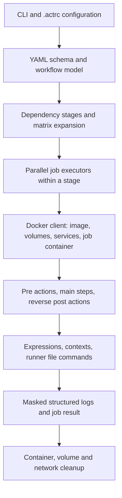
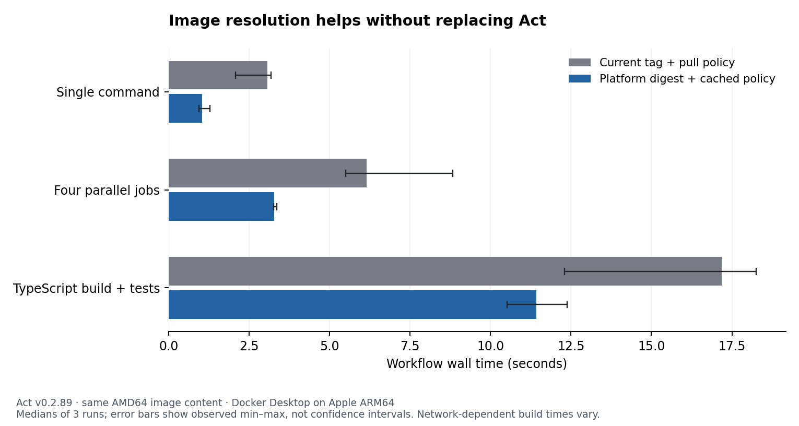

# Should Act Dock replace Act?

Research date: 2026-10-28. Application baseline: `b71aad89437f89becee13aa8f2ed714eb418e1b9` (released as v0.2.4). Execution engine: the checksum-verified macOS ARM64 release of Act v0.2.89, not a rebuilt or modified engine.

## A. Executive summary

**Keep Act and optimize the integration first. Evolve the existing background runner into a stronger orchestration layer only where product requirements justify it. A complete engine replacement is not justified by the evidence collected here.**

There is useful performance work to do, but much of it concerns image resolution, network access, dependency caches, workspace policy, and application logging. Act already communicates directly with Docker through its Go client. Docker API integration, arbitrary images, secrets files, parallel jobs, action caches, and structured step logs do not require a replacement engine.

The most consequential findings are:

- A trivial AMD64 workflow on this Apple Silicon/Docker Desktop host normally spends seconds reaching the first step, while Act consumes about a tenth of a host CPU-second. Rewriting YAML parsing is not a credible general explanation for that delay.
- The obvious `--pull=false` optimization was initially ineffective: Act v0.2.89 inspected a multi-platform tag as ARM64, compared it against the requested AMD64 platform, and pulled again. A platform-specific reference is necessary to test genuinely cached-image execution here. This is a concrete engine/image-store interaction, not proof that a new engine is needed.
- Cold external action acquisition can dominate both time and memory. For the same pinned `setup-node` action, the legacy cache's cold run took 69.588 seconds and peaked at 495.797 MiB of host RSS. The opt-in shallow cache's cold run took 27.971 seconds and peaked at 61.609 MiB. These are single cold observations, not a controlled universal speedup ratio. The source explains the different fetching paths.
- Repeated npm installs benefit from a dedicated cache volume using existing Act flags. Offline-action mode alone does not cache npm packages.
- Act executes independent jobs concurrently. Act Dock serializes entire workflow invocations. Those are different scheduling layers.
- Act's planner groups jobs into stages and waits for a whole stage before advancing. This can unnecessarily delay a dependent job behind an unrelated slow job. Changing that behavior requires work inside the engine, or a carefully specified alternate backend; it does not require throwing away Act's other compatibility machinery.
- The real application scheduler adds measurable CPU and memory, especially for large log bursts. Improvements to log persistence and delivery belong in Act Dock.

**How much faster would a custom engine be? Unverified.** No custom engine was created or benchmarked. The measurements establish removable costs and conditional bounds, not a defensible blanket percentage. Keeping the same Docker image, architecture, fresh-container isolation, action implementations, and build commands preserves much of the cost under every option.

The [generated results](results.md), [methodology](methodology.md), [source evidence index](sources.md), and [raw evidence directory](evidence/) support this report. Measured observations, source findings, engineering projections, and untested possibilities are explicitly distinguished below.

## B. Reverse-engineering findings

### Evidence and REA's role

REA 6.8.0 was acquired through its official `rea-agents` package and used through the CLI. No persistent agent registration or global tool installation was required. It was used to bind the actual shipped executable to its source, inspect its native layout, observe normal execution, compare execution configurations, and deliver a timed cancellation to a running workflow. This is useful binary/runtime evidence rather than decompiling source code that is already available.

| REA operation | Evidence | What it establishes |
| --- | --- | --- |
| `inspect-go-binary` | [Go build information](evidence/rea-go-binary.json) | ARM64 Mach-O; Go 1.25.0; Act v0.2.89; embedded VCS revision `4f411281417e88660bea1c1a1749aa71ae0bd60f`; `vcs.modified=false`; compiled Docker/Moby, go-git, YAML, and actionlint modules. Binary SHA-256 `bb1af0c344a0fe52e5ef7b2e43ac8cdf956219cd71118299f8b940ff89bb8173`. |
| `inspect-macho`, `inspect-binary-layout` | [Mach-O](evidence/rea-macho.json), [layout](evidence/rea-layout.json) | Native architecture, entrypoint, file/linked layout and dynamic-library metadata. These do not establish execution hotspots. |
| `capture-process`, current configuration | [capture](evidence/rea-current-capture.json), [scenario](evidence/rea-current-scenario.json) | The real binary reaches the marker and exits successfully; retained PTY frames and sampled host processes. |
| `capture-process`, offline/pull configuration | [capture](evidence/rea-optimized-capture.json), [scenario](evidence/rea-optimized-scenario.json) | Another successful run. Process observation was incomplete; the capture explicitly reports truncation/unknowns. |
| `compare-process-captures` | [comparison](evidence/rea-process-comparison.json) | Reports changed terminal/lifecycle observations and unknown process/filesystem dimensions. It does **not** establish equivalence or an engine speedup. |
| `capture-process`, cancellation | [capture](evidence/rea-cancel-capture.json), [scenario](evidence/rea-cancel-scenario.json) | The sleep-step marker appears before SIGINT, dispatched at 4,005 ms. Cancellation-related frames follow at approximately 4,000–4,110 ms. Act exits with code 1; a separate Docker query finds no remaining matching job container. |

REA evidence identifiers include `ev_2d56466426bc6956657055cb923d62d4adf468afa0cbd8b4a6ae1d425441589f` for build information and `ev_bd86918ce05478526a75982a67263bd8c76193df5d27f797e90a477834d964b9` for cancellation. Each original record contains its own subject, provider, limitations, and evidence links.

REA's process sampler is not a syscall tracer and cannot observe container processes through the host process tree. It reports withheld/unverified host-process environments. Its cleanup result concerns owned host processes, not Docker resources. Docker events and the separate post-cancel query provide the container evidence. No Hopper/Ghidra/IDA decompilation was needed or performed, and no comprehensive dynamic call graph is claimed. See [REA's process-capture contract](https://github.com/morluto/rea/blob/2b8fb387b6d1204f6c6e8abb89d075b7d95ba402/docs/process-capture.md).

The normal capture also samples `gh auth token` and Docker credential-helper descendants. That is runtime evidence of configuration/authentication subprocesses even though container execution itself uses the Docker API. Their existence must not be generalized into a “Docker CLI per step” claim.

### Act's execution path

All source links below are expanded into commit-pinned function locations and file digests in [sources.md](sources.md).

| Concern | Verified packages and functions | Findings and implications |
| --- | --- | --- |
| Configuration | `cmd/root.go: args`, `configLocations`, `newRunCommand`; `cmd/platforms.go: newPlatforms` | Config-file arguments precede explicit CLI arguments. Repeated image mappings are applied in order, so Act Dock's appended mappings win over `.actrc` for the same labels. File-based env, secrets, inputs, vars and explicit options are merged before planning. |
| YAML interpretation | `pkg/model/workflow.go: ReadWorkflow`, `Workflow.UnmarshalYAML`; `pkg/schema` | Uses `yaml.v3`, resolves aliases and validates against embedded workflow schemas. Dynamic expressions remain YAML nodes where needed. Act Dock's own YAML parser only discovers/validates UI-facing workflow metadata; it is not an execution-compatible replacement. |
| Plan and dependencies | `pkg/model/planner.go: NewWorkflowPlanner`, `PlanEvent`, `PlanJob`, `createStages`, `mergeStages` | Computes required jobs and transitive dependencies, then serial stages containing parallel runs. Cycles/unresolvable dependency graphs fail planning. `-j` includes dependencies, which prevents naïvely scheduling one `act -j` per job without duplicate dependency execution. |
| Scheduling | `pkg/runner/runner.go: NewPlanExecutor`, `GetConcurrentJobs`; `pkg/common/executor.go: NewParallelExecutor` | Stage barriers, concurrent job pipelines, and separate matrix parallelism. Default concurrent jobs derives from the host CPU count, not a memory-aware budget for Docker Desktop's VM. Matrix parallelism is another nested limit, not a strict global container budget. |
| Docker communication | `pkg/container/docker_run.go: GetDockerClient`, `create`, `start`, `exec`; `docker_pull.go` | Uses Moby's Go API client, including environment-selected connections and SSH helpers. Log messages saying `docker exec` are descriptions of SDK operations, not evidence of a Docker CLI subprocess per step. Docker credential helpers may still be subprocesses. |
| Job lifecycle | `pkg/runner/run_context.go: startJobContainer`, `GetBindsAndMounts`, `GetNodeToolFullPath`; `job_executor.go: newJobExecutor` | A persistent job container executes multiple shell/JS steps; it is not recreated for each normal step. Initializes runner files, services and Node discovery; runs pre/main/post phases; unwinds post actions in reverse. |
| Reuse and cleanup | `run_context.go: stopJobContainer`; `job_executor.go`; `pkg/container/docker_volume.go`; `common.Executor.Finally` | Successful jobs normally clean up unless reuse is selected; `--rm` also requests cleanup after failure. Docker clients are closed. Cleanup has cancellation-independent contexts. Reusing dirty containers changes isolation and can conflict with Act Dock's unconditional labeled-container cleanup. |
| Expressions and conditions | `pkg/runner/expression.go`; `pkg/exprparser/{interpreter,functions}.go`; `pkg/runner/step.go` | Evaluates actionlint expression ASTs against GitHub/job/needs/steps/matrix/strategy/env/secrets/inputs/vars contexts. Includes coercions, object traversal, status functions, interpolation and filesystem hashing. Conditions, output propagation and outcome/conclusion distinctions are compatibility work, not just string replacement. |
| Action types | `step_factory.go`; `action.go: runActionImpl`, `execAsDocker`; `step_action_{local,remote}.go`; `step_docker.go` | Supports run steps, local/remote actions, JavaScript actions, Docker actions and composites. JS actions execute Node in the job environment; Docker actions can use separate containers/images. Builds and pre/post hooks need their own lifecycle semantics. |
| Reusable workflows | `pkg/runner/reusable_workflow.go` | Local and remote workflow-call executors reuse planning/expression/context logic. Existence of this support does not imply complete GitHub parity. Act Dock currently rejects reusable-workflow call jobs without standard `runs-on` metadata before they reach Act. |
| Action acquisition | `step_action_remote.go: prepareActionExecutor`; `pkg/common/git/git.go: NewGitCloneExecutor`; `action_cache.go: GoGitActionCache.Fetch` | Legacy acquisition uses go-git and a process-local clone mutex; normally fetches even when a cache exists. Offline mode skips refresh when content is available. The opt-in cache uses shallow ref fetching and tar archives. It still has network semantics; it is not automatically an offline content-addressed store. |
| Workspace and filesystem | `step_action_remote.go: main`; `docker_run.go: copyDir`, `CopyTarStream`; `run_context.go: GetBindsAndMounts` | Local checkout can be implemented by archiving current working files into the job volume. Directory copying creates a temporary tar file, traverses files with ignore rules, and uploads an archive. Bind mode avoids copying but exposes live files and can be slower for filesystem-heavy operations on a VM share. Actions have additional transfer paths. |
| Caches | `cmd/root.go`; `pkg/artifactcache`; `run_context.go` | Image layers, action source caches, `act-toolcache`, package-manager caches and workflow `actions/cache` are separate systems. Act starts a local cache handler unless disabled/external configuration is supplied. Artifacts require explicit server configuration. None makes an arbitrary `npm ci` cache persist automatically. |
| Secrets and environment | `cmd/root.go`, `cmd/secrets.go`; `run_context.go`; `step.go`; `docker_auth.go` | Supports dotenv-style secret/env/var files, per-run secrets, expressions, file commands and registry credentials. Loading a global secret context is different from exporting every secret as an environment variable. Only explicitly mapped env/action inputs should receive needed secrets. |
| Logging and progress | `logger.go: WithJobLogger`, `withStepLogger`, `valueMasker`; `command.go`; `job_executor.go: useStepLogger` | JSON includes jobs, matrix, main-step IDs, stages, raw output, results and elapsed execution time. Setup/cleanup use lowercase `stepid`; normal steps use `stepID`. Masks modify message text; other JSON fields must not be assumed redacted. |
| Errors and cancellation | `step.go: runStepExecutor`, `monitorJobCancellation`, `evaluateStepTimeout`; `job_executor.go`; common executor combinators | Propagates errors, step timeouts, continue-on-error and condition reevaluation; attempts post-step and resource cleanup after cancellation. REA verifies one actual sleep cancellation, not every action/service failure mode. Job-level timeout/permissions/environment semantics have gaps. |

The public [unsupported-functionality page](https://nektosact.com/not_supported.html) is a useful warning list, but its cancellation/summary wording should not override the inspected version's source and runtime behavior. Step cancellation code is present and the probe succeeds. The source also has `processRunnerSummaryCommand`; summary handling depends on configuration and should be tested before exposing it. Missing job-level semantics must not be confused with supported step-level timeouts and continue-on-error.

The official [GitHub runner](https://github.com/actions/runner/blob/4197182ef8f39c719f66038c1bc9b34cd9e9ac9a/src/Runner.Worker/JobRunner.cs) consumes an `AgentJobRequestMessage` and implements workers, action management and container lifecycles. It is not a drop-in local YAML-to-job scheduler. Reusing worker code would leave workflow planning, service-side semantics and protocol adaptation to us.

## C. Performance analysis

### What was measured

The reproducible fixtures cover a single shell command, Node dependency installation, TypeScript compilation/tests, twelve shell steps, a pinned external JS action, four independent jobs, repeated runs, two image sizes, and an asymmetric dependency graph. Additional probes exercise the actual application scheduler, a 10,000-line output burst, a persistent npm cache, shallow action fetching, native architecture, platform-specific digests, a 64 MiB/2,048-file workspace, and Docker cgroup metrics.

See [results.md](results.md) for every included cohort's sample count, median, observed range, time to first main step, host CPU and peak host RSS. There is no averaged-together “cold vs warm” number: image, action, package and container states are identified separately. Docker was started once; VM boot time was not included in workflow durations. No user's existing image or cache was deleted to manufacture a cold run.

Key primary-cohort medians, with the cached medium image and AMD64 execution:

| Workload | Current flags | Pull/offline flags only | Interpretation |
| --- | ---: | ---: | --- |
| Single command | 2.248 s | 2.674 s | No speed win; image-platform inspection still triggers a pull. |
| Node install and assertion | 8.473 s | 10.042 s | Network/package installation dominates; action-offline mode does not preserve npm cache. |
| TypeScript install/build/test | 11.648 s | 11.086 s | Overlapping ranges; no strong optimization claim from three samples. |
| Twelve shell steps | 4.027 s | 3.865 s | Per-step Docker exec/file-command work is visible; CPU remains small. |
| Four independent two-second jobs | 6.092 s | 5.443 s | Act is already parallel. Current-policy maximum was 25.009 s. |
| Asymmetric dependency graph | 9.429 s | 9.488 s | Pull flags do not remove the stage barrier. |

The 25.009-second parallel outlier is retained. Its trace shows two job containers not reaching creation until about 21.8/22.3 seconds after invocation, after their pull phase, while the other two jobs had already finished. This is not evidence of expensive YAML scheduling: host CPU for the entire invocation was only 0.27 seconds.

The **clean, separately paired platform-digest cohort** resolves the same AMD64 runner content rather than using the multi-platform tag:

| Workload | Current tag / default pull median | Platform digest / cached policy median | First main step, current → digest |
| --- | ---: | ---: | ---: |
| Single command | 3.075 s | 1.047 s | 1.984 → 0.742 s |
| Four independent jobs | 6.153 s | 3.282 s | 2.737 → 0.977 s |
| TypeScript fixture | 17.179 s | 11.427 s | 2.424 → 0.671 s |

Each cell has three observations; all min/max values are in the generated results. This demonstrates useful improvements with the existing engine. The TypeScript total also includes variable npm download time, so attributing the entire total difference to image resolution would be unjustified. A diagnostic pilot overlapping Go toolchain setup was conservatively excluded and repeated cleanly; all its raw data remains marked in the evidence.

The [SVG chart](image-policy-benchmark.svg) and plotting script are retained for export. Error bars represent observed ranges, not confidence intervals.

For **the app's default auto/native architecture**, disabling refresh did avoid the cached-image mismatch on this host: minimal-run medians were 2.900 seconds current and 1.509 seconds optimized, with first main step 2.767 versus 0.420 seconds. The native TypeScript total did not reliably improve (7.711 versus 9.082 seconds), reinforcing that faster setup is not a guarantee of a faster network-dependent build. These native and AMD64 cohorts must not be mixed into a language/engine speed comparison.

### Host CPU, memory and disk versus container resources

Typical direct Act trials have approximately 39 MiB peak host RSS and 0.09–0.29 host CPU-seconds, excluding the cold legacy action-fetch spike. This does not include Docker's daemon, VM, Node compiler or workflow processes. Replacing Go with Rust cannot be credited with reclaiming the container's build memory.

The separate source microbenchmark puts the existing two-job YAML/schema read at **0.507–0.512 ms/op**, about 377 KB allocated per operation, and dependency planning on the already parsed model at **0.757–0.773 microseconds/op**, 1,200 bytes allocated. These are measured upstream APIs under Go 1.26.6, not the release compiler, full CLI startup or a large-workflow extrapolation. They strongly argue against parsing this small workflow being a seconds-scale bottleneck. Retained [benchmark output](evidence/model-bench.txt), [CPU profile summary](evidence/model-cpu-top.txt), and [allocation profile summary](evidence/model-memory-top.txt) expose the scope; the profiles emphasize repeated schema/JSON allocation and runtime work in this microbenchmark, not Docker execution.

In the separate 68-sample TypeScript resource profile, Act's sampled RSS averaged 27.865 MiB and reached 31.859 MiB. The job cgroup's reported memory usage averaged 148.695 MiB and reached 398.449 MiB. These are sampled observations, not lifetime peaks or allocation profiles; cgroup memory includes cache. Between first and last observed samples, container CPU increased by about 11.962 CPU-seconds. The last reported block-I/O write count was 37,797,888 bytes; reads reported zero. Cached reads and VM/filesystem layers mean that zero is not evidence of no physical reads.

The uninstrumented timing harness's macOS `time -l` reported zero block-input/output operations for these host processes and did not expose physical disk byte counts. Those unavailable fields stay null. No universal disk-I/O reduction or entire-system average memory is inferred. [Resource profile](evidence/resource-profile.json) retains the underlying counters. Its instrumented wall duration must not be compared to uninstrumented runs as a regression.

### Application overhead

The separate paired scheduler cohort invokes the real `Store`, `Scheduler`, workflow validation, dependency checks, log parsing, JSONL persistence, SQLite indexing, process management and final cleanup in disposable storage. It excludes the GUI and socket transport, and includes starting a fresh Bun harness, whereas the installed runner normally persists.

For a minimal run, direct and scheduler medians were 3.781 and 3.821 seconds; that wall difference is too small relative to noise to claim a stable added delay. Host CPU increased from 0.110 to 0.750 seconds and peak command-accounted RSS from 38.969 to 100.641 MiB. For 10,000 log lines, medians were 3.301 and 4.576 seconds, with host CPU 0.160 versus 1.380 seconds. This supports investigating synchronous persistence/indexing, while not assigning the entire difference to logging alone. See the integration harness and complete ranges.

### Bottleneck classification

| Cost | Owner / origin | Evidence | Reasonable response |
| --- | --- | --- | --- |
| Missing image transfer and unpack | Registry/network/Docker | Small-image cold trial 39.180 s; subsequent trials 4.461–5.079 s | Preflight/pre-pull with progress; explicit image/digest/architecture; user-controlled refresh. |
| Cached tag still accesses registry | Act policy plus image-store/platform interaction | ForcePull default and retained architecture-mismatch messages | Test platform-specific resolution; prefer correct existing variant; upstream targeted fix if needed. |
| Container setup, attach, Node detection | Docker + Act lifecycle | Docker events and start-to-main logs | Measure phase durations; maintain fresh isolation by default; do not call the whole setup slice “parser overhead.” |
| External action acquisition | Act go-git/cache path plus network | Cold legacy/shallow/offline probes and source | Stable per-ref caches; evaluate shallow cache and immutable-ref resolution; avoid unnecessary refresh. |
| npm package work | Workflow/dependency manager + cache policy | Persistent-cache cold 9.954 s; warm 5.301/5.470 s | Per-project locked caches with explicit sharing policy. |
| Workspace tar/copy | Act filesystem path + VM storage | 64 MiB comparison and `copyDir` | Offer copy/bind policy, apply ignore rules, measure actual projects before choosing defaults. |
| Per-step environment-file round trips | Act + Docker API | `runStepExecutor`, Docker exec/archive events | Candidate targeted engine patch; preserve file-command ordering and action compatibility. |
| Stage barrier | Act planner/executor | A/B/C probe and `createStages`/`NewPlanExecutor` | Targeted readiness-scheduler change; differential tests for needs, failure and cancellation. |
| Workflow runs wait behind unrelated runs | Act Dock | One `busy` flag and one `current` process | App-level resource-aware workflow queue; prevent overlapping workspace/cache races. |
| Output delivery and persistence | Act Dock | Per-line sync file write/SQL indexing; polling intervals; output-burst probe | Batched writes/index transactions, bounded buffers, durable cursor events and long polling/push. |

### Current Act, optimized Act, custom engine

| Metric | Current Act | Optimized Act | Completely custom engine |
| --- | --- | --- | --- |
| Startup / first step | Measured per cohort in results | Measured flags, digest and native cohorts; correctness of platform resolution matters | Unverified. Cannot give a supported point estimate. With the same fresh-container policy, Docker setup still remains. |
| Workflow duration | Measured fixtures, including cold/warm distinctions | Measured cache/image/scheduling controls, not a shipped product change | Unverified; same workflow commands and images impose the same command/pull costs. |
| Peak host memory | About 39 MiB typical; 495.797 MiB in one cold legacy acquisition | About 39 MiB typical; shallow cold action sample 61.609 MiB | Unknown; no defensible numeric range before architecture and implementation exist. |
| Average memory | Separate sampled host/cgroup profile above | No complete comparable optimized lifetime profile | Unknown; do not extrapolate Rust or Go language choice into a memory guarantee. |
| Host CPU | Measured per workload; normal execution small, legacy cold acquisition substantial | Existing cache paths materially reduce acquisition CPU in the measured example | Unknown; copying/parsing/network stacks still allocate and run under any language. |
| Concurrency | Independent jobs already overlap; app runs serialize | App can run multiple isolated Act processes; Act can limit jobs/matrices | Unverified throughput; constrained by VM CPU/RAM, image contention and user commands. |
| Cache performance | Legacy action and image policies measured | Offline/shallow/action caches, npm volume and correct platform selection demonstrated | Potentially comparable; a new cache is not inherently faster or safe to share. |

### Conditional projections, not performance promises

Let a workflow's measured critical-path time be `T = P + D + W + A + C + L + Q`, with pull/registry work `P`, Docker/runtime setup `D`, workspace transfer `W`, action/dependency acquisition `A`, command execution `C`, log/engine work `L`, and queue/barrier waits `Q`. Concurrent work must be analyzed on the critical path; summed job durations cannot simply be subtracted from wall time.

| Proposed optimization | Current behavior / alternative | Beneficiaries and limits | Requires replacing Act? | Projection and confidence |
| --- | --- | --- | --- | --- |
| Direct Docker API | Act already uses it | No new benefit attributable to avoiding a CLI it does not use | No | Additional saving from this change alone: **zero**, high confidence for inspected path. |
| Correct image caching | Re-pull policy and platform mismatch → explicit platform resolution | Cached short jobs benefit; absent images still need transfer | No; app configuration and possibly upstream fix | Use measured digest cohort. Cross-host range not established; medium confidence in mechanism, low in generalized magnitude. |
| Avoid reparsing / subprocess startup | Go starts/plans once per invocation → persistent service | Tiny many-run workloads; long builds see little benefit | Usually a fork/API extension, not a new compatibility engine | Conservative lower bound on gain is zero. Upper removable wall slice cannot exceed the measured setup/engine portion. Host CPU is a measure of work, not a bound on latency hidden by I/O. Low magnitude confidence. |
| Dependency/action caches | Re-fetch/reinstall → immutable-ref and package caches | Repeated installations and network-heavy actions | No | Cold/warm observed ranges in results; future network and cache-hit rate unknown. No universal ratio. |
| Readiness scheduling | Level barrier → launch when that job's own needs complete | Asymmetric DAGs; no gain for linear workflows | Modify Act, or new engine | For idealized A=1 s, B=4 s, C≈0 depending only on A, **C can start 0–3 s earlier** if other costs are equal. Total workflow makespan gain is approximately zero in that exact fixture because B still dominates. If C had duration `d`, ideal command-only saving would be `min(3,d)` seconds. Analytical, high confidence in topology; actual setup costs unverified. |
| Workspace bind/snapshot | Repeated tar upload → bind or validated snapshot | Large trees; can regress VM filesystem-heavy builds | No for bind; snapshot cache may need engine work | Use measured copy/bind ranges. Both improved and regressed samples occurred. Medium confidence in workload dependence, low in other-project speed estimates. |
| Container pools / reuse | Fresh jobs → prewarmed resources | Very short, repeated, trusted workloads | Act reuse exists; safe pools need substantial lifecycle work | Possible saving lies between zero and measured fresh-setup cost, and can be negative after reset/verification. Low confidence; deliberately not benchmarked because isolation differs. |
| Event streaming | JSON logs + polling → typed durable events / long polling | UI latency and large log bursts | App changes; engine hooks improve semantic coverage | Current log poll waits 0–800 ms when caught up, plus processing/transport. Removing that polling wait can improve perceived responsiveness by that interval, not necessarily workflow completion. Source-derived range; high confidence in configured timer, no measured end-to-end UI latency. |
| Cross-workflow parallelism | One invocation at a time → bounded independent processes | Independent workspaces with spare resources | No | Two independent equal-duration runs ideally approach one run's duration rather than two; actual gain ranges from no benefit/regression to that ideal bound. No multi-workflow throughput benchmark performed. |

A hypothetical custom engine's expected performance remains unverified. We do not publish a made-up “20–50% faster” estimate. Small-n observed ranges, topology-derived bounds, and unknowns are the honest limits of this study.

## D. Three architectural options

| Criterion | A — Keep Act, improve integration | B — Product orchestration around Act | C — Own complete Docker execution engine |
| --- | --- | --- | --- |
| Performance | Improve demonstrated image/cache/I/O costs using existing controls | Same execution speed opportunities plus cross-run admission and monitoring | Potential engine-internal optimization, unverified; Docker/build costs remain |
| Memory / CPU | Retain small ordinary engine footprint; avoid legacy acquisition spikes | Add a persistent coordinator but budget container concurrency | New footprint unknown; language alone does not establish a win |
| Compatibility | Preserve current Act behavior, test upgrades | Preserve Act semantics if each workflow stays intact | Must reproduce expressions, actions, workflows, file commands and edge cases |
| Images and secrets | Act already supports core transport/configuration | Rich project UI, credential brokerage, policy and audit | Complete policy control with much more implementation surface |
| Reliability | Small change surface; retain existing integration tests | More lifecycle/state reconciliation to design | Initial reliability substantially less established |
| Security | Improve allowlists, credentials, socket exposure and cache trust | Central policy and ownership accounting | Own every escape, injection, cleanup and masking boundary |
| Complexity | Lowest; incremental improvements | Medium; durable scheduler/events/resource ownership | Highest; compatibility program, not just Docker exec |
| Maintenance | Track bundled Act/image versions and adapter tests | Also maintain coordinator APIs, policies and reconciler | Track GitHub semantics, marketplace assumptions and all runtime changes |
| Scalability | Existing per-workflow job/matrix concurrency | Bounded multi-workflow scheduling with workspace locks | Custom DAG scheduling possible; still host-resource bound |
| Developer experience | Fix obvious image/secrets/log controls | Stable typed runs/events, metrics, recovery and debugging workflows | Deepest internal control, accompanied by new failures/incompatibilities |
| Long-term value | Fastest route to current user needs | Own differentiated product behavior while retaining compatibility work | Valuable only if engine-level requirements become a proven product differentiator |

**A pros:** low disruption; measured improvements available; easy fallback; retain upstream fixes and working marketplace behavior. **A cons:** CLI/log adapter remains a boundary; internal DAG and file-command behavior stay upstream-controlled; configuration precedence requires care.

**B pros:** strong UI/MCP/CLI consistency, resource-aware runs, explicit cache/security policy, metrics and recovery without reimplementing expressions. **B cons:** more moving parts; cross-run container/cache/name collisions; coarse cancellation/inspection boundaries; still cannot transparently replace Act's internal scheduler.

**C pros:** direct semantic events and lifecycle control; own ready-queue scheduler and resource admission; opportunity to optimize fine-grained execution boundaries. **C cons:** no verified speed advantage; expensive compatibility work; reduced initial marketplace coverage; new security/regression burden; larger long-term support obligation.

The current application already resembles a small hybrid: persistent Bun runner, SQLite history, CLI/MCP clients, and Act subprocesses. B describes a deliberate expansion of that boundary, not a need to add a new daemon just to call existing flags.

## E. Feature gap analysis

“Engine work” means a targeted Act change/API extension is sufficient in principle. None of these product requests establishes that a complete replacement is mandatory.

| Desired capability | Act already provides | Current Act Dock gap | Appropriate owner |
| --- | --- | --- | --- |
| Arbitrary runner images | `-P label=image`; job `container.image` | Four labels hardcoded to one mutable tag; no selector | A: global/project/run image UI and validated mappings. Workflow `container.image` can already select an image under an accepted label. |
| Match Ubuntu version/tool inventory | Versioned/custom/full runner images | 20.04, 22.04 and 24.04 all map to `act-latest` | A: explicit version mapping, inventory information and capability checks; a new engine cannot supply absent tools. |
| Local image detection/prepull | Docker image inspection/pull; health UI already prefetches default | Health assumes one constant; multiarch detection needs care | A/B: resolve effective image and platform before checking/prefetching. |
| Private registries | Docker credential config/helper and container/service credentials | Missing helper PATH produced the actual release failure in this repository's history | A: environment/credential-helper diagnostics; B for a credential broker. No private-registry execution benchmark here. |
| Manual secrets and `.env` import | `--secret`, `--secret-file`, `--env-file`, dotenv parser | UI stores file references; no manual secret editor or encrypted vault | A/B: use existing transport with OS-backed storage. `.env` variables and `${{ secrets.* }}` must remain distinct. |
| Project secrets / overrides | Per-invocation secret context and action inputs/env | No project vault, preview or merge policy | B product policy; engine replacement unnecessary. |
| Selective injection | Workflow env/inputs and secret expressions | No grant/review UI; files may contain too much | A/B: explicit grants, required-name diagnostics; strict per-step enforcement may need an engine policy hook. |
| Missing-secret diagnostics | Missing values resolve through expressions; Act accepts supplied files | App does not enumerate required references | A/B: static reference scan with warnings, runtime expression diagnostics; dynamic references require an “unknown” state. |
| Secure persistence | Message masking; no full secret vault | Path-based plaintext files remain external; history stores requests | B: native keychain/credential manager/secret service, short-lived restricted files or inherited-name secrets. Never put secret values into command/history metadata. |
| Real-time logs | JSON stream over stdout/stderr | Synchronous per-line write and SQL; 800 ms log polling | A/B: batching, bounded backpressure, resumable notifications. |
| Step progress | IDs/stages/results/timings in normal-step JSON | Setup IDs use another casing; some skipped events only logged at debug; message markers partly drive UI | A: versioned adapter and fixtures from real binary output; engine hook if complete semantic events are required. |
| Job metrics | Docker stats/events expose cgroup counters | No persistent metrics sampler | B: container ownership registry, bounded sampling; needs no rewrite. |
| Faster cancellation | Signal-aware contexts and cleanup | App sends TERM, KILL after 5 s; Docker cleanup is best-effort | A/B: phase-aware cancel state, ownership reconciliation and deadline diagnostics. Tested only direct Act SIGINT here. |
| Failure history / diagnostics | Structured results, messages and process exit | History exists; broad errors still need effective config/context | A/B. Preserve masked evidence and phase-specific failures. |
| Concurrent workflows | Multiple Act processes possible | Single `busy/current` run; no budgets/workspace locks | B. Validate deterministic names and shared-cache behavior before enabling. |
| Parallel jobs/matrices | Already implemented and benchmarked | No UI job/matrix budget controls | A; B for global admission. |
| `concurrency` groups / cancel-in-progress | Not implemented as GitHub semantics | No group policy | B for invocation-level groups; job-level evaluated grouping needs engine changes. |
| Workflow/reusable/label coverage | More support exists than app exposes | `validateRun` rejects custom/dynamic/non-Ubuntu labels and no-runs-on reusable calls | A: improve validation/capability negotiation without allowing host execution unintentionally. |
| Caching and repeated runs | Action/image/tool/cache-server mechanisms | No cache policy/size/refresh controls; npm persistence not automatic | A/B; measured prototypes use existing flags. |
| Pause/resume a job at exact step boundaries | Not a complete CLI contract | No control protocol | Engine extension needed for dependable semantics. Pausing processes/containers is not checkpointed workflow resume. A full rewrite still optional. |
| True readiness DAG and semantic event hooks | Stage barrier and logging API | Cannot repair transparently in the UI | Engine work: upstream contribution or narrow fork before considering C. |

Act Dock's docs say other labels follow `.actrc`, but the current validator rejects those labels first. Similarly, `.actrc --reuse` does not override the app's labeled-container removal, and a CLI `--container-options` label can override options supplied by config. Effective configuration should be explicit in the product, not guessed from raw flags.

## F. Engineering cost, disadvantages and security

### Compatibility is the hard part

A shell-only runner is straightforward compared with a GitHub Actions execution engine. The costly parts include expression coercion/status behavior; matrix expansion and exclusions; needs/skipped/failed/cancelled outputs; JavaScript runtimes and pre/post state; composite nesting; reusable workflow inputs/secrets; Docker action mounts; service networks/readiness; shell quoting on host/container paths; environment/output/state/path file protocols; cache/artifact protocols; masks; cancellation and post cleanup; and changing GitHub semantics. Existing Act support is imperfect, but abandoning it exchanges known gaps for a much larger initial gap.

Full parity with GitHub-hosted runners cannot be delivered merely by implementing a Docker executor. Hosted images, VM-level capabilities, platform services, token issuance, OIDC and environment approval behavior are separate dependencies. A desktop tool must define a documented local subset. The [GitHub workflow reference](https://docs.github.com/en/actions/reference/workflows-and-actions/workflow-syntax) is a moving compatibility target.

### Security and reliability boundaries

- Docker is mandatory, but Docker socket access is a powerful host/VM authority. Act mounts the socket by default; ordinary workflows should have an explicit policy for whether they need it. The benchmark's direct cohort disables that mount; the actual-app harness retains production behavior.
- A fresh job container is a useful reset boundary. `--reuse`, shared writable workspaces, broad npm/tool caches and pools can carry files, credentials or poisoned artifacts into subsequent work. Namespace by project/trust/ref as appropriate and never describe dirty reuse as equivalent isolation.
- Normal log messages are masked; arbitrary JSON metadata, encoded/transformed secrets, artifacts and malicious actions are not guaranteed secret-safe. Act Dock's whitelist of log fields is worth preserving. Raw debug logs should not be enabled globally just to get skipped-step events.
- The runner inherits its process environment. Constrain what a child receives and how credentials are granted. Act can also discover a GitHub token through `gh`; expose that behavior in policy rather than assuming every run has no credentials unless a secret file is selected.
- Multiple invocations can have deterministic container names for the same workflow/job. A label is useful for cleanup but does not itself make names unique. Workflow queueing must coordinate same-project runs or safely isolate them.
- Crash recovery needs durable ownership of containers, networks, volumes and pending cleanups. The current store marks runs interrupted; that alone cannot prove orphaned Docker resources were reconciled.
- Windows process-tree cancellation, Linux socket permissions and macOS Docker Desktop paths need separate validation. Results from this Mac do not establish cross-platform performance or correctness.

These are product/engine implementation responsibilities to evaluate, not reasons to silently broaden this research into security-related production changes.

### Licensing and reuse

Act, REA and `actions/runner` have MIT licenses in the inspected repositories. A fork or redistributed substantial source must retain the relevant copyright/license text; Act Dock already ships `act-LICENSE.txt`. REA is a research tool here and is not added to the product's runtime dependencies. Its optional tool/provider dependencies have separate licenses; using REA does not relicense those dependencies.

Act's dependency graph includes separately licensed components, such as the Moby/Docker client, go-git, actionlint, YAML and logrus. A fork or library embedding would require a dependency-specific notice inventory, not just Act's MIT file. Apache-licensed components may carry notices and modification-marking conditions. Container image contents and downloaded marketplace actions have their own licenses; the image builder's license does not cover every bundled tool. These are identified obligations/scope, not a completed redistribution audit. Retain a versioned SBOM/notices review before shipping reused code. [Act license](https://github.com/nektos/act/blob/4f411281417e88660bea1c1a1749aa71ae0bd60f/LICENSE), [runner license](https://github.com/actions/runner/blob/4197182ef8f39c719f66038c1bc9b34cd9e9ac9a/LICENSE), [REA notices](https://github.com/morluto/rea/blob/2b8fb387b6d1204f6c6e8abb89d075b7d95ba402/THIRD_PARTY_NOTICES.md).

### Technology choice if engine work becomes justified

| Technology | Strengths | Costs / performance evidence | Fit |
| --- | --- | --- | --- |
| Go | Existing Act types, evaluators, Docker client, tests and distribution knowledge; easy targeted fork | GC/allocation spikes exist in legacy acquisition, but different cache implementation already reduces them. No new-engine speed benchmark. | Best fit for engine-internal work or a focused fork. |
| Rust | Strong ownership/types; mature async/network tooling; potential control over allocation | Must recreate or bridge a much larger compatibility surface; Docker API parity and GitHub expressions still require engineering. No measured memory/speed advantage for this project. | Consider only for a narrowly specified new subsystem with a proven need. |
| TypeScript/Bun/Node | Matches runner/UI contracts; quick product integration; accessible JSON/event tooling | New semantics, subprocess/lifecycle behavior and large event loads still need care; existing Bun harness has higher process-accounted RSS. Cross-platform packaging already handled by app but not proof of engine reliability. | Keep orchestration, UI policy, storage and adapters here. |
| C# / official worker reuse | Mature GitHub worker and expression/template components | Consumes job-request protocols, not local workflows; adds .NET/runtime/protocol adaptation and still needs a planner. | Investigate as a separate compatibility strategy only if requirements change. |

No language comparison here is a benchmark. There is no evidence that a language rewrite is the right performance optimization.

### Effort model

These are low-confidence planning ranges in **engineer-weeks**, not measured delivery times. Assume two experienced engineers familiar with Actions and Docker, reuse of permissively licensed components, an explicit Linux-container subset, existing desktop packaging, dedicated CI fixtures, and time for review/testing. Parallelism does not divide all tasks evenly. New team experience, broader platforms and support interruptions expand the ranges.

| Phase for C | Incremental effort | Deliverable / principal uncertainty |
| --- | ---: | --- |
| Shell-only MVP | 8–16 engineer-weeks | YAML/schema, simple expressions, DAG, fresh Docker jobs, shell steps, cancellation, event persistence; explicitly incompatible with much marketplace usage. |
| Common-workflow compatibility | +16–36 | JS/Docker/composite actions, matrix/needs/outputs, environment protocols, service containers, secrets; edge cases multiply. |
| Production reliability | +24–52 | Cross-platform daemon/paths, cancellation trees, crash reconciliation, cache/security policy, conformance/regression corpus and release support. |
| Advanced Actions coverage | +24–72 | Reusable workflows, nuanced expression/status semantics, service/cache/artifact protocols and changing upstream behavior. No full-parity promise. |
| Measured optimization | +8–24 | Profile proven hotspots after correctness exists; complexity depends on where time actually goes. |
| Ongoing maintenance | Roughly 0.5–1.5 engineer FTE/year initially | Compatibility triage, image/runtime changes, security updates and support; broad adoption can require more. |

Through production reliability, this is approximately **48–104 engineer-weeks** before advanced coverage and dedicated optimization. The range is a bottom-up scope estimate, not a deadline or a precise cost forecast. Highest delay risks are expression edge cases, action lifecycle semantics, reusable workflows, cross-platform cleanup, and diagnosing user-image/tool mismatches that a new engine does not solve.

For comparison, A's first useful configuration/cache/log improvements are a planning range of roughly 4–8 engineer-weeks; B's durable multi-run coordination, events and metrics are roughly another 8–20 engineer-weeks after defining isolation and resource policies. These can be staged and stopped based on observed user value. They are not implementation commitments made by this research.

## G. Recommended architecture

Keep the existing Act subprocess boundary. Own product configuration and durable runs/events in the Bun background runner. Introduce a small versioned executor adapter contract as needed: validate effective configuration, start a whole workflow, normalize masked events, cancel, collect owned-resource identifiers, and reconcile after restart. This is an architectural recommendation only; no such adapter was implemented here.

Act should continue to own workflow schema execution, expression evaluation, needs/matrix semantics, action resolution/execution, file commands, and the job/service lifecycle. The app should own project preferences, credential grants/storage, effective image/platform policy, run admission, history, event transport, health and diagnostics, metrics retention, and UX.

For the confirmed stage barrier or a need for lossless typed events, first evaluate an upstream contribution or a narrow Go fork/API extension. Keep that change testable against pinned Act behavior. Calling `act -j` for each job is not a transparent workaround: it includes dependencies, repeats work, and loses the shared outputs/contexts needed for correct orchestration.

The strategic ownership worth buying now is the user's configuration, observability, resource policy and debugging experience. Owning the entire Actions compatibility implementation has not yet demonstrated commensurate value.

## H. Optimization roadmap and decision gates

1. **Effective images and architecture.** Add global/project/run preferences and label maps, honor versioned labels, surface the resolved image/digest/platform, and make health/prefetch use that result. Preserve Node/shell requirements and workflow `container` semantics. Test containerd multi-platform inspection and the default-native path. Include an explicit refresh policy instead of unconditional pulls or permanent staleness.
2. **Secrets UX with existing Act transport.** Separate env/vars/secrets import, choose merge precedence, use native secret storage, resolve per-run grants without storing plaintext values in history, and report missing/static/unknown references. Test masking across message and metadata boundaries.
3. **Action/package/cache policy.** Evaluate shallow action fetching and immutable commit caching on a real workflow corpus; retain offline/refresh controls. Introduce opt-in project-scoped package-cache mounts and cache sizing/clear controls. Verify artifact/cache-server reachability before promising those features.
4. **Logging and monitoring.** Batch durable log/index writes, preserve lifecycle events independently of the visible log cap, normalize both setup/normal field variants, add resumable event notifications and Docker phase/metrics sampling. Benchmark high-output runs and measure actual UI event latency. Keep secret-safe field selection.
5. **Bounded concurrency and recovery.** Replace the single-run admission policy only after specifying per-project/workspace locks, unique container ownership, shared-cache locking, CPU/RAM budgets and restart reconciliation. Test concurrent invocations of identical workflows before exposing the option. Preserve serial mode.
6. **Targeted engine work only if warranted.** Measure how often stage barriers extend real critical paths; define semantic event/debug requirements that CLI wrapping cannot meet. Prototype and differential-test a narrowly scoped upstream/fork change before proposing a replacement.

Before claiming an optimization, use at least 20 warm samples per relevant platform/configuration on a quieter host, separate independent cold-cache trials, pin compatible images/actions, and verify equivalent outputs, failure/cancellation cleanup and secret handling. The three-repeat study identifies mechanisms and priorities; it does not establish release-grade p95 claims.

Reopen C only when the optimized Act baseline still misses an explicitly agreed performance or capability target, a representative corpus demonstrates that the remaining bottleneck is engine-internal, a compatibility budget/subset is acceptable, and a small authorized prototype shows an advantage large enough to justify ongoing ownership. Agree that target with product requirements rather than inventing a rewrite-justifying percentage afterward.

If C later passes those gates: keep Act as the default/fallback, introduce a separately selectable backend behind the adapter, run side-by-side differential fixtures (never duplicate deployment side effects), migrate only supported workflow subsets, retain per-project rollback, and expand coverage from measured failures. This is a conditional migration plan, not authorization to develop C now.

## I. Weighted decision matrix

Scores are engineering judgments from 1 (poor) to 5 (strong), not measurements. Performance, memory and CPU remain neutral for C because its expected behavior is unverified. Compatibility and maintenance carry substantial weight because the product executes users' existing workflows. Complexity scores favor smaller changes. Security scores reflect implementation confidence, not formal certification.

| Criterion | Weight | A | B | C |
| --- | ---: | ---: | ---: | ---: |
| Compatibility | 20% | 4 | 4 | 2 |
| Performance opportunity | 15% | 3 | 3 | 3 |
| Security/control confidence | 10% | 3 | 4 | 2 |
| Reliability | 10% | 4 | 4 | 2 |
| Engineering complexity/cost | 10% | 5 | 3 | 1 |
| Maintenance burden | 10% | 4 | 3 | 1 |
| Developer experience | 10% | 4 | 5 | 5 |
| Flexibility/control | 5% | 4 | 5 | 5 |
| Scalability | 5% | 3 | 4 | 4 |
| Memory | 3% | 3 | 3 | 3 |
| CPU | 2% | 3 | 3 | 3 |
| **Weighted total / 5** | **100%** | **3.75** | **3.75** | **2.55** |

The A/B tie is intentional: both preserve Act and pursue most of the same benefits, while exchanging simplicity against stronger orchestration. A wins sequencing because it addresses immediate gaps with less architectural work; B should be added selectively. Moving 5 percentage points from complexity to developer experience favors B by 0.15. This sensitivity does not justify C: even granting C the maximum performance score adds only 0.30, leaving its compatibility/cost burden decisive under these weights.

**Decision:** retain Act; optimize image resolution, caches, secrets and logs; expand orchestration where demonstrated needs require it. Keep a focused fork/upstream patch available for the small set of engine-internal gaps. A custom engine's speed advantage remains unverified, and the currently requested benefits mostly do not require one.
